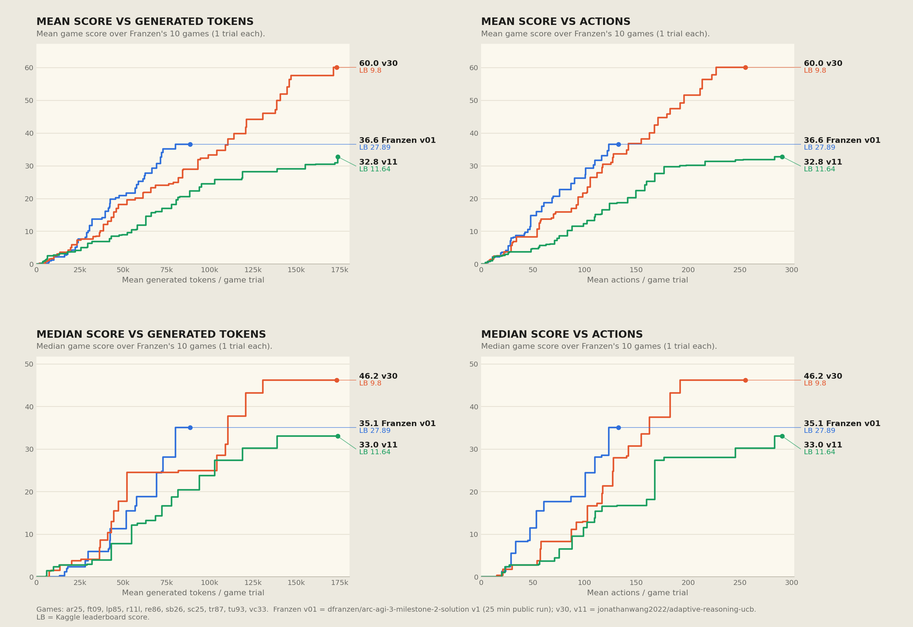

# ARC3 Milestone 2 (Sept.30) report on Daniel Franzen's [solution](https://github.com/da-fr/arc-agi-3-solution)


Comparison between Franzen and our baseline [v30](https://www.kaggle.com/code/jonathanwang2022/adaptive-reasoning-ucb/log?scriptVersionId=352814869) (public best, score=9.80) and [v11](https://www.kaggle.com/code/jonathanwang2022/adaptive-reasoning-ucb/notebook?scriptVersionId=350922985) (hidden best, score=11.64)[^1]
10 games included here: `ar25`, `ft09`, `lp85`, `r11l`, `re86`, `sb26`, `sc25`, `tr87`, `tu93`, `vc33`. 

[^1]: 9.80 is actually v32's score but it has the same source bundle as v30 and v30 used wave=2 that's why I used v32's score. 

# Confirmed insights

1. More context is beneficial for solving games (when starts diminishing?) especially for hard ones
2. More information is helpful at making more informed decisions. (Daniel and us both had `animations`, he had death image, we could have `intermediate_frames`)
3. Lower tokens per action (TPA) gives an edge. (Advanced tools seems to make it lower.)
4. World model is neutral or negative. (Is it possible to make it work? Appending it at the first user turn is better than at the last user turn. Supported by paper [Trace as State](https://arxiv.org/pdf/2609.02702v1) Confirmed locally? )
5. Adaptively allocate resources: compute time based on momentum, context based on difficulty.


# Detailed comparisons
## Serving

His write-up: [§1 Model and serving](../WRITEUP.md#1-model-and-serving), [§2 Retaining only useful Mamba checkpoints](../WRITEUP.md#retaining-only-useful-mamba-checkpoints).

### Configuration

Sources: Franzen's `serve.log` startup `server_args` ([notebook](https://www.kaggle.com/code/dfranzen/arc-agi-3-milestone-2-solution) v1); v30's `vllm.log` non-default args and `kv-pool.json` (`runs/kaggle/jonathanwang2022/adaptive-reasoning-ucb/v30`).


| Parameter            | Franzen v01                                             | Our v30                                                       |
| -------------------- | ------------------------------------------------------- | ------------------------------------------------------------- |
| Engine               | SGLang Pennyroyal v2.5.3 + 5 patches                    | vLLM 0.28.1rc1.dev417 (SPN bundle)                            |
| Context length       | 58 - 116Ki, 136Ki max                                   | 26 - 36Ki, 48Ki max                                           |
| Concurrency          | 10                                                      | 28                                                            |
| KV capacity          | 1,011,264 tokens                                        | 1,043,988 tokens                                              |
| Memory fraction      | 0.96 static                                             | 0.98 GPU util                                                 |
| Mamba cache          | 60 slots, BF16 SSM, 3.2 GB                              | None?                                                         |
| Prefill chunk        | `chunked_prefill_size=8192`, `max_prefill_tokens=16384` | `max_num_batched_tokens=6144` (chunked prefill on by default) |
| Speculative decoding | EAGLE/MTP draft, 3 steps, 4 draft tokens                | None                                                          |
| Prefix caching       | Radix cache + Mamba sparse-prefill/LRU patch            | `enable_prefix_caching`                                       |
| Scheduler            | `lpm` (longest prefix match), page size 64              | Default, async scheduling                                     |
| Tool parser          | `qwen3_coder`                                           | `qwen3_xml`                                                   |
| Weight load          | 269 s (prefetch lookahead)                              | 701 s                                                         |
| Startup to ready     | 7 m 46 s                                                | 14 m 30 s                                                     |


### Metrics

His write-up: [§2 Trimming in larger blocks](../WRITEUP.md#trimming-in-larger-blocks) (his prefix-reuse measurements on an earlier run), [§2 Limiting concurrent admission](../WRITEUP.md#limiting-concurrent-admission-to-protect-the-cache).

Each run's game window only: Franzen 25 min with 10 games; v30 2 h 12 min with 25 games.


| Metric                                | Franzen v01                                     | Our v30                                          |
| ------------------------------------- | ----------------------------------------------- | ------------------------------------------------ |
| Harness throughput (toks/s)           | 588.0                                           | 581.5                                            |
| Decode throughput, mean / p90 (tok/s) | 671 / 833                                       | 603 / 767                                        |
| Running requests, mean                | 8.9 of 10                                       | 22.1 of 25                                       |
| Decode speed per request (tok/s)      | ~75                                             | ~27                                              |
| Queue, mean / max                     | 0.0 / 1                                         | 0.1 / 9                                          |
| Speculative accept length, mean       | 2.67 (rate 0.56)                                | n/a                                              |
| KV usage, mean / max                  | 56% / 95%                                       | 59% / 73%                                        |
| Prefix reuse                          | **94.2%** (token-weighted, all prefill batches) | **58.4%** (mean of vLLM sliding-window hit rate) |
| **New prefill per generated token**   | **2.2**                                         | **6.5**                                          |


### Comments

- SGLang is more optimzied engine if we treat it right. This matters when Qwen4-flash drop. 
- Speculative Decoding is faster on SGlang. This was the opposite on vLLM: the MTP head's weights (2.7–5.2 GB BF16, see `duck-harness/notes/plan_0922.md`) and per-request speculative state come out of the KV-cache budget, and at our 25–28 running requests the decode batch is already large, so drafting adds verify work with little latency left to hide. Franzen keeps that overhead small on SGLang: 3.79 GB of draft weights, 0.96 GB of draft KV and 0 GB of intermediate SSM state (`gdn_mtp_cache_mode=none`;).
- Keep KV usage high. Keep prefix reuse high.


## Harness

His write-up: [§2 Increasing context size](../WRITEUP.md#2-increasing-context-size), [§4 Board images](../WRITEUP.md#board-images), [§5 Stopping failed action sequences](../WRITEUP.md#5-stopping-failed-action-sequences).

### Configs
```json
{
  "tool_output_tokens": 3072, // ours: 1024
  "MULTIMODAL_CONTEXT": "current_grid",
  "ARC3_EXPLAIN_GAMEPLAY_CHANGED": "1", // expose `result.gameplay_changed` vs the whole `board_changed`
  "ARC3_ANIMATION": "1",
  "ARC3_ANIMATION_TIMELINE": "1",
  "ARC3_DIFF_IMAGE": "1", 
  "ARC3_ACTION_INFO": "1", // what
  "EXPOSE_UNDO": "on", // ours: off
  "EXPOSE_RESET": "off", // same
  "ARC3_PERSISTENT_FUNCTIONS": "1", // same
  "ARC3_PERSISTENT_FUNCTIONS_SCOPE": "game",
  "ARC3_PERSISTENT_FUNCTIONS_IMPORTS": "1",
  "ARC3_MEMORY_SECTIONS": "off",
  "ARC3_FRAME_DIFF_HINT": "1",
  "ARC3_LEVEL_TRANSFER_GUIDANCE": "1"
}
```

- ARC3_ANIMATION: expose `last_animation_frame`
- ARC3_MEMORY_SECTIONS: world model fields
- ARC3_ANIMATION_TIMELINE: `ARC3_ANIMATION_TIMELINE`
    "The code executed 1 action in the previous sequence.
    Executed actions: MOUSE(row=45, col=30).
    The last executed action (`MOUSE(row=45, col=30)`) animated over 13 frames and left the board area unchanged, but it was not a no-op: 151 cells changed and changed back around rows 4-47, cols 10-47. Whatever this action did is visible only there - read `last_animation_timeline` before concluding it failed."
- 


## API

His write-up: [§4 Animations](../WRITEUP.md#animations), [§4 Object-level changes with frame_diff](../WRITEUP.md#object-level-changes-with-frame_diff), [§4 Return faithful action results](../WRITEUP.md#return-faithful-action-results), [§4 Retaining Python functions](../WRITEUP.md#retaining-python-functions).

Ours is `api_schema.py` on branch `advanced-tools` (unmerged). Theirs is from his system prompt (`prompts.py`) and sandbox globals. Identical parts are left out: `current_frame`, `valid_actions`, `result`, the `action(list[str | dict])` input (MOUSE uses `row`/`col`), `Frame.level` / `.shape`, node `color` / `boundary` / `children`, and `adjacency_list`.

**Frame**

```python
# Franzen
class Frame:
    ascii: str                     # letter-coded board; raw grid deliberately hidden
    step: int                      # env step count

# Ours
class Frame:
    grid: list[list[str]]          # 1-char colors, [row][col]; NumPy available
    step_id: int                   # index into history.steps; initial board = -1
```

**Segmentation node**

```python
# Franzen: segmentation['nodes'] is a list
class Node:
    id: int                        # list index, top-most then left-most
    hash: str                      # color + shape, rotation-INVARIANT
    pose_hash: str                 # color + shape, rotation-sensitive
    shape_hash: str                # shape only, color-free
    rotation: int | None           # 0/90/180/270 from canonical; None if fully symmetric
    rotational_symmetry: int       # 1, 2 or 4
    pixels: int

# Ours: segmentation['nodes'] is a dict keyed by id
class Node:
    id: str                        # '<shape_id>#<k>'
    shape_id: str                  # color + shape, rotation-sensitive (= his pose_hash)
    area: int                      # = his pixels
    bbox: list[int]                # [r0, c0, r1, c1]
```

**Time model and history**

```python
# Franzen: flat lists
history: list[HistoryEntry]        # includes the initial seeded frame
class HistoryEntry:
    action: str
    frame: Frame                   # board AFTER the action; history[-1].frame == current_frame
    result: ActionResult
transitions: list[Transition]      # real actions only; auto-RESET is its own transition
class Transition:
    action: str
    before_frame: Frame
    after_frame: Frame             # .frame is an alias
    result: ActionResult           # result.automatic=True for the auto-RESET

# Ours: turns and steps with stable IDs
history: History                   # .turns: list[Turn], .steps: list[ActionStep]
class Turn:
    id: int
    before_frame: Frame
    after_frame: Frame
    steps: list[ActionStep]
    level: int
    board_changed: bool
    net_board_changed: bool        # turn endpoints differ
    diff: FrameDiff | None         # lazy endpoint diff
class ActionStep:
    id: int
    turn_id: int                   # auto-RESET is attached to the preceding turn
    action_name: str
    action_data: dict
    before_frame: Frame
    after_frame: Frame
    board_changed: bool
    level: int
    level_changed: bool
    diff: FrameDiff | None
    result: ActionResult
    animation: Animation
    has_animation: bool
```

**Latest-state shortcuts**

```python
# Franzen
previous_frame: Frame | None       # board before the latest real action
last_action: str | None
last_action_frame: Frame | None    # == current_frame after an action
last_transition: Transition | None
latest_frame: Frame                # alias of current_frame
last_action_call_result: dict      # whole latest action(...) call; persists across turns;
                                   # never overwritten by the auto-RESET

# Ours
last_turn: Turn | None             # latest completed turn
last_frame: Frame | None           # last_turn.before_frame
                                   # latest action: history.steps[-1]; no persistent call result
```

`action()` **result**

```python
# Shared: executed, score, reward, state, board_changed, level_completed, game_over, done,
#         run_complete, level, action_num, executed_actions, executed_count, requested_count,
#         stopped_early, stop_reason, stop_detail, timing

# Franzen only
gameplay_changed: bool             # change more than 4 cells in from the edge (HUD ignored)
no_op: bool
gameplay_changed_per_action: list[bool]
no_op_action_index: int
skipped_actions: list[str]
blocked_action: str                # refused by a guard
fatal_action: str
animation: dict                    # {frames, transient_pixels, transient_bbox}
automatic: bool                    # per transition: harness auto-RESET
# action() also prints a one-line echo into stdout

# Ours only
# none: board_changed includes the HUD; animation lives on ActionStep
```

**Animation**

```python
# Franzen: latest animated action only, fetched lazily
last_animation_frames: Sequence[Frame]
last_animation_timeline: dict      # {action, frames, steps: [{step, changed, bbox, changes | transitions}]}

# Ours: every step, for the whole game
last_animation: Animation | None   # also history.steps[i].animation
class Animation:
    action_name: str
    step_id: int
    frames: Sequence[Frame]        # lazy
    sampled_indices: tuple[int, ...]   # frames used for prompt images
```

**Frame diff**

```python
# Franzen: object-level
def frame_diff(before: Frame | None = None, after: Frame | None = None) -> dict: ...
    # defaults previous_frame -> current_frame; shape mismatch -> changed_cell_count = -1
    # {changed_cell_count, moved, rotated, appeared, disappeared, changed_color, resized}

# Ours: pixel-level
def frame_diff(before: Frame | list[list[str]], after: Frame | list[list[str]]) -> FrameDiff: ...
diff = frame_diff
    # both arguments required; shape mismatch -> ValueError
    # {cells_changed, groups: [{from_color, to_color, count, bbox, cells}]}
```

**Python environment**

```python
# Franzen
# - fresh process every call; validated top-level defs are re-exec'd for the whole game
# - stdlib allowlist (+ difflib); no NumPy, no file I/O
class TerminalStateActionError(BaseException): ...   # action() after game_over / level_completed / win
class StaleStateActionError(BaseException): ...      # 2nd action() after a no-op in one snippet
                                                     # (+ optional no-op / death / repeat guards)

# Ours
# - persistent interpreter: variables, functions and imports survive across calls
# - NumPy, open(), private workspace directory
def read_file(path, start=1, count=100) -> str: ...
def write_file(path, text) -> str: ...
def edit_file(path, old, new) -> str: ...
def grep(pattern, path=".") -> list[tuple[str, int, str]]: ...
def reset() -> None: ...           # clear the interpreter, keep files
help()
```

**Unique to his**
- Rotation-aware segmentation: `hash` (rotation-invariant), `shape_hash` (color-free), `rotation`, `rotational_symmetry`.
- Object-level `frame_diff` with Hungarian matching and defaults.
- HUD-aware `gameplay_changed` / `no_op` and per-action stop details.
- `last_action_call_result` that persists across turns and survives auto-RESET; `automatic` flag per transition.
- Animation diff timeline and transient-pixel summary.
- `BaseException` guard errors that `except Exception` can't swallow.
- Action echo in stdout.

**Unique to ours**

- Turn/step time model with stable IDs, `turn_id`, `level_changed`, and lazy per-turn and per-step `diff`.
- Whole-game animation history with `sampled_indices`.
- Raw `grid` access and NumPy.
- `bbox` on nodes; shape-encoding string ids.
- Persistent interpreter with `reset()`, workspace file I/O, and `help()`.


**Comments**
- Both exposed intermediate frames and animation frames (more information for agent to decide.)
- Both make python tools persistent while we further create a workspace for agent to use. 
- They introduce rotation symmetry into nodes which could be helpful but limited. He could come up with this probably because of his experience working with arc2 transformations.
- Our `bbox` is helpful. 

## Prompts

His write-up: [§4 Significant prompt changes](../WRITEUP.md#significant-prompt-changes), [§4 Adding the UNDO action](../WRITEUP.md#adding-the-undo-action).

## User Prompt

**theirs**
- Retained functions snippet
```
Your retained functions from earlier Python calls in this game: bbox_of(color), cbox(), box(color, minpx=50), box2(color, minpx=50, exclude_edge=True), comps(minpx=8), cells_of(frame, color, minpx=1), find_piece(frame, tmpl, anchor=(18, 15)), ppos(frame, tmpl, anchor=(18, 15)), clist(frame), bcomp(px), lpos(), lpos2(), line_row(), dots_on_line(), bbb(px), norm(s), flipv(s), fliph(s), sym_about_row(s, ax), sym_about_col(s, ax), fill(s), hline_row(), hrows(), p88(). These are your previous definitions, available to call directly. Their presence does not mean they are correct; revise them if new evidence contradicts their assumptions.
```
- Diff imaged (help frame_diff())

- Still has the redundant tufa templates
```
Keep tool output compact: use `current_frame.segmentation` as the primary view, and `current_frame.ascii` only for a small specific region; never print full boards...
```

- 10x image instead of 4 
    - Is this really necessary? 
    - I had tests comparing x4 vs x8 on qwen3.8-27b. THere is no difference between x4 and x8. It may well be transferrable to flash-next since they have the same vision encoder. But I could be wrong since flash-next might be more detail-oriented.

#### System prompts
Their full [system prompts](./prompts/daniel-system-prompt.md) vs [ours](./prompts/ours-v32-system-prompt.md)


## Resource allocation

Both allocators rank games, but at different moments. Our UCB re-ranks every 300 s quantum and can park a game whose prefix is still warm. His priority gate re-ranks only when a game trims its context, the one moment its prefix is already lost.

### Ours: UCB (v32)

Every game gets one 300 s warm-up quantum. After that, each free slot goes to the eligible game with the highest score, for another 300 s quantum:

$$
\text{score} = \underbrace{(1-w)\,\frac{W}{T} + w\,\frac{\Delta W_{32k}}{\min(T,\ 32000)}}_{\text{momentum}} \;+\; \underbrace{c\,\sqrt{\frac{\ln(1 + t)}{A}}}_{\text{exploration}}
$$

where
- `W = L(L+1)/2`: weighted levels, with L = levels completed (the benchmark weights level k by k)
- `T`: lifetime generated tokens of the game
- `ΔW_32k`: the gain in W over the last 32,000 generated tokens (a token window, not the context window)
- `w = recent_weight = 0.5`
- `t`: minutes since allocation started (shared clock)
- `A`: lifetime actions of the game (`ucb_denominator = "actions"`); `A = 0` scores ∞, so unvisited games go first
- `c = ucb_c = 0.0002`

Progress is sampled at completed analyzer turns. A quantum yields only after the current response and its tools finish, never mid-request. Ties go to the game with less service, then the one admitted least recently. Code: `inference/framework/allocation.py` (`ucb_score`, `Progress.rates`), selection in `solver.py`.

v32 `allocation`:
```json
{
    "policy": "ucb",
    "ucb_denominator": "actions",
    "ucb_c": 0.0002,
    "recent_weight": 0.5,
    "quantum_seconds": 300,
    "extension_concurrency_per_server": 25,
    "waves": 1,
    "serving_budget_minutes": 532,
    "kaggle_public_serving_budget_minutes": 132
}
```
With `waves: 1`, the games are split into two sequential cohorts, each with half of the remaining budget; time never moves between waves.

### Franzen: priority gate

His write-up: [§3 Allocate computation where it can still help](../WRITEUP.md#3-allocate-computation-where-it-can-still-help), [Fade future value near the end](../WRITEUP.md#fade-future-value-near-the-end), [Preserve prefix reuse while scheduling](../WRITEUP.md#preserve-prefix-reuse-while-scheduling).

All games start at once, but a gate admits only 10 at a time (`ARC3_MAX_ACTIVE_STREAMS=10`, matching the server's 10 running requests); the others wait with their state frozen. An admitted game keeps its slot across tool calls and only hands it over when it trims its context. At that point it re-enters the queue, and the highest-priority waiter gets the slot, which may be the same game.

$$
P = (A + B_{\text{eff}}) \cdot C
$$

$$
A = \ell \left(\frac{25}{25 + a}\right)^{2} \frac{55}{N(N+1)/2}, \qquad
C = 0.25 \cdot 2^{-(a/115)^2} + 0.75 \cdot 2^{-(t/62000)^2}
$$

$$
B_{\text{eff}} = B \cdot \min\left(1, \frac{r}{0.2\,T_{\text{run}}}\right), \qquad B = 8 / 7 / 5 / 0 \text{ for } \ge 3 / 2 / 1 / 0 \text{ levels left after this one}
$$

where
- `ℓ`: current level; `a`, `t`: actions and generated tokens spent on this level only (reset at each level-up)
- `N`: the game's level count from metadata, clipped to 6–10 (fallback 10); the `55/(N(N+1)/2)` factor normalizes A to a 10-level game
- `A`: value of finishing this level, with the benchmark's action-efficiency penalty
- `B`: value of the levels after it (heuristic, not fitted); faded linearly to 0 over the last 20% of the run (`r` = time remaining)
- `C`: chance this level still completes, fitted on 725 level attempts from four earlier runs (Gaussian falloff in actions and tokens)

#### A and B in detail

His own explanation of A, B and C, with the calibration plots: [§3](../WRITEUP.md#3-allocate-computation-where-it-can-still-help).

**A is what finishing the current level would add to the game score.** The benchmark weights level k by k and scales it by action efficiency, roughly `min(1, (human / used)²)`. A copies that shape with three factors:

- `ℓ`: the weight of the current level. Level 6 is worth 6× level 1.
- `(25 / (25 + a))²`: an efficiency estimate. 25 stands in for the human action count, and `a` is the actions already spent on this level. The level isn't finished, so it uses `25 + a` (roughly "about 25 more actions to go") rather than the final count. It falls fast: 1.0 at a = 0, 0.51 at 10, 0.25 at 25, 0.11 at 50, 0.04 at 100.
- `55 / (N(N+1)/2)`: converts to a 10-level scale. A level is a bigger share of a short game's score: 1.0 for N = 10, 1.53 for N = 8, 2.62 for N = 6.

**B is the value of the levels after this one.** You can only reach them by finishing this level first. It's a lookup on N − ℓ, the levels left after this one: 8 for three or more, 7 for two, 5 for one, 0 on the last level. For an 8-level game that's 8, 8, 8, 8, 8, 7, 5, 0 for levels 1 to 8. B is a hand-set heuristic: no normalization by N, no efficiency term. In the final 20% of the run it fades linearly to 0, because there's no time left to reach later levels.

**How they interact.** B (up to 8) is usually far larger than A early in a game (≈ 1–3), so mid-game ranking is mostly "does this game still have levels ahead" × C, the spend decay. A takes over in two places: on a game's last level (B = 0), where a high, efficient level can still win, and near the deadline as B fades.

Worked examples, computed with his `priority_value`:

| Game | ℓ / N | a | t | A | B | C | P | P with 5% of the run left |
| --- | --- | --- | --- | --- | --- | --- | --- | --- |
| X | 2 / 10 | 10 | 20k | 1.02 | 8 | 0.95 | 8.53 | 2.85 |
| Y | 6 / 6 (last) | 5 | 5k | 10.91 | 0 | 1.00 | 10.87 | 10.87 |
| Z | 3 / 8 | 150 | 100k | 0.09 | 8 | 0.20 | 1.62 | 0.41 |

Y is on its last level and cheap so far, so A alone ranks it first. X ranks high mid-run because of B, but drops below Y once B fades. Z has burned 150 actions and 100k tokens on one level, so both A and C collapse and it goes to the back of the queue.


A new game enters at priority `2,000,000 − queue position`, so every game gets its first turn before any trimmed game comes back. With `ARC3_PRIORITY_REFRESH_QUEUE=1`, every waiter is re-scored on one shared clock each time a slot frees. Code: `priority_scheduler.priority_value`, `_PriorityGate` and `_maybe_handover` in `tool_agent.py`.

Notebook settings:
```python
ARC3_MAX_ACTIVE_STREAMS = 10
ARC3_PRIORITY_REFRESH_QUEUE = '1'
ARC3_PRIORITY_TAIL_LOOKUP = 'remaining'      # B = 8/7/5/0
ARC3_PRIORITY_SCORE_NORMALIZATION = '1'      # normalize A only
ARC3_PRIORITY_TAIL_FADE = '1'
ARC3_PRIORITY_TAIL_FADE_FRACTION = '0.2'
ARC3_PRIORITY_PACE = '0'
# defaults: human actions 25, action scale 115, token scale 62000, action weight 0.25
```

### Side by side

| | Ours (UCB, v30) | Franzen (priority gate) |
| --- | --- | --- |
| Concurrent games | 25 | 10 |
| When ranking happens | Between 300 s quanta | When a game trims its context |
| Can park a warm prefix | Yes | No |
| Signal | Past reward per token: lifetime plus last 32k tokens | Value of finishing this level plus later levels, discounted by spend on this level |
| Exploration | `c·sqrt(ln(1+t)/A)` bonus | None; new games enter first, then priority only |
| Uses the level count | No | Yes (`number_of_levels`) |
| Deadline-aware | Shared budget, 2 waves | Tail B fades over the last 20% |
| Fitted constants | `c`, `recent_weight` | 25, 115, 62000, 0.25, 8/7/5, 0.2 |

### Comments
- Ours is more general: no game metadata, few constants, and it rewards demonstrated progress. His encodes more structure (the scoring formula, level counts, a fitted completion curve), which helps when that structure holds but may not transfer.
- The bigger difference is when a game loses its slot, not the score. Trim-time handover costs no extra prefill, while a 300 s quantum can park a game with a warm 36 Ki prefix and make the next game pay a cold prefill.
- A port would keep his trim-time handover and use our UCB score inside it. His gate truncates priorities with `int()`, which would turn reward-per-token values (~1e-4) into 0, so it needs float priorities first.
- At 128 Ki a game holds its slot until its first trim (30–50 turns), so UCB exploration would act on longer, less even slices than our 300 s quanta. A maximum hold time is the obvious knob to A/B.

# Reflections
## Why I didn't figure out those things
- I realized that animations are important and I included them but I delibrately dropped animations leading to game over because I thought it would be screen flash rather than game useful dyanmics. This is helpful to understand the real reason for the death rather than getting trapped in a loop of `wait, game over again?` on game such as ``. I realized this on Sept.29. 
- I rejected an idea too early when it introduced bugs and actually hurt the performance such as persistence python functions and even workspace. But it turns out the edit trigger some bugs that actually negatively impact such as variable overwritten, name hallucinations. Once fixed those, results are positive. 
- Again, I used agent to use optimzied sglang serving for flash next. I even searched for recipes for other people using flash next on sglang. Both didn't work well. I still dont' understand why his sglang engine works faster.
- I knew more context is gonna help so adaptive context will be a plus. However, I didn't carry out this path fast and clean enough. Also this should be built on top of the optimized engine for serving longer context.


## What we could have done better for the next month
- Develop an insights to have a sense of what might likely work what might not. Make sensible choices. Don't do things for no reason.
- Once we chosen a path, give it a little bit more patience. Sometimes the feature didn't work because of extra errors introduced. Always read the logs carefully. 
- *Coordinate ideas* testing among group memebers more effiently instead of we doing random stuff uncoordinated. Team size can be huge boost if we could communicate and collaborate efficienctly.()

# Next things to try
- To be discuss with the group