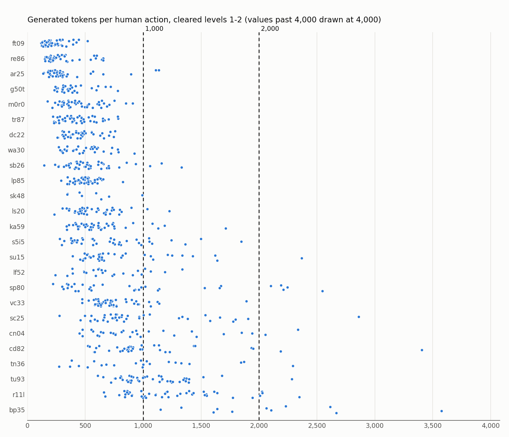
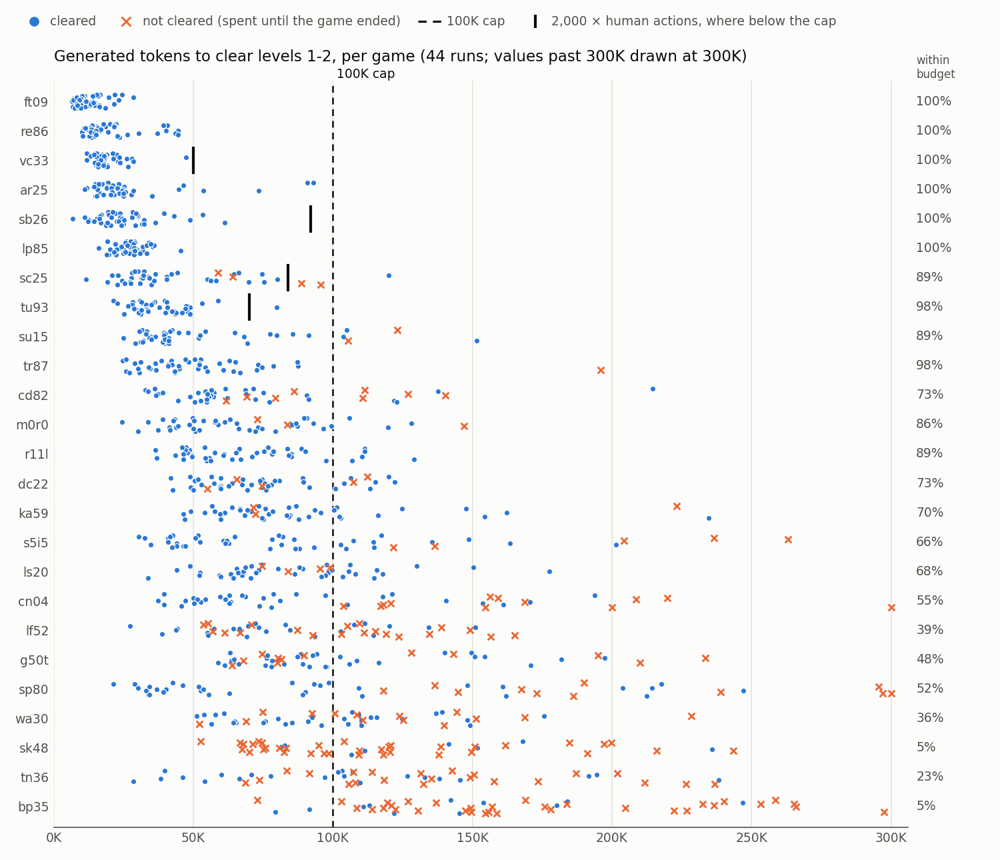
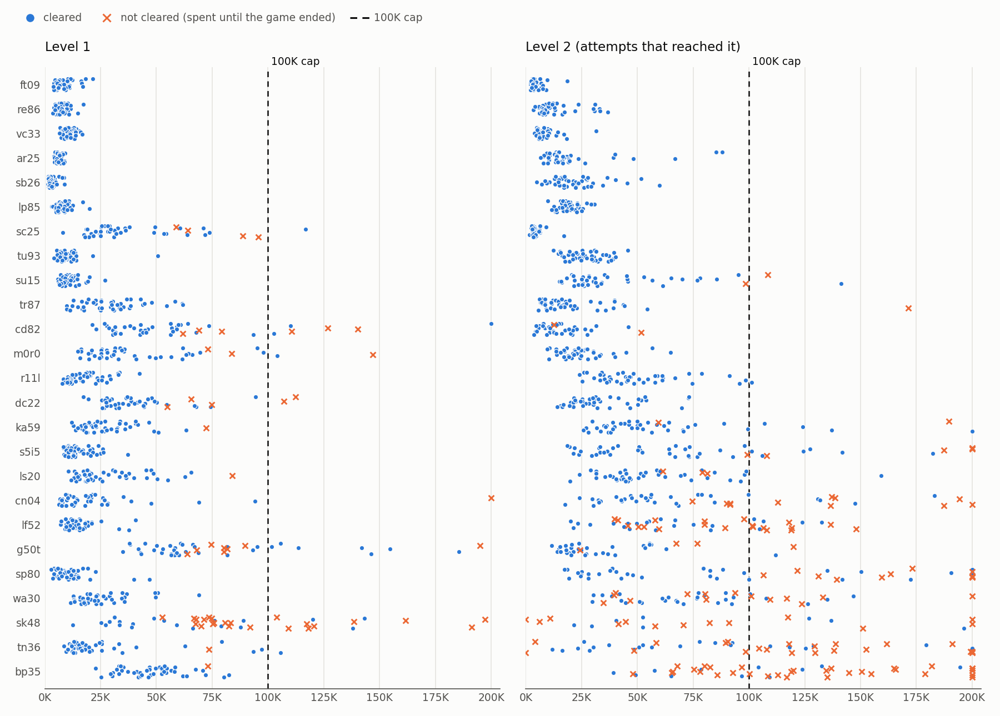

# Token budget for GRPO on levels 1–2 (2026-10-21)

**Proposal under test:** a GRPO rollout must clear levels 1 and 2 within

  budget = min(100K, 2,000 × human actions of L1 + L2)

generated tokens (thinking, replies and tool code). The 2,000 comes from the assumption that the model spends 1,000–2,000 tokens per action.

**Verdict:** the budget is reasonable, but it is effectively a flat 100K. The assumption behind the 2,000 is too high: per human action the model spends a median of 575 tokens, so 2,000 × human actions exceeds 100K for 21 of the 25 games. 70% of historical attempts clear L1 + L2 within the budget (82% clear eventually with no limit). That leaves 11 games in the 20–80% range, where GRPO groups have mixed outcomes and the most signal.

Script: [scripts/l1_l2_token_budget.py](scripts/l1_l2_token_budget.py). It writes the figures below and prints the numbers in this doc. Context: [RFT v1 A/B](rft-v1-kaggle-ab.md), the reason we move to GRPO on the early levels.

## Data

- 44 Kaggle runs of 25 games each, all with the base model, 10-01 to 10-16. A run counts if it scored ≥ 30, which drops crashed and 5-minute smoke runs; the RFT runs are excluded. That gives 1,100 attempts (one game in one run).
- The harness versions and serving quantizations (Lord NVFP4, Intel W4A16) vary between runs, so this is the spread across our recent setups, not one configuration.
- Tokens come from each run's `evaluation.json` progression (cumulative generated tokens at each level clear). Human action counts come from `benchmark.json` (`base_actions_per_level`).
- A cleared attempt is counted at the L2 clear. An attempt that did not clear L2 is counted at the end of its game: time ran out or the scheduler parked it. That number is a lower bound on what clearing would have cost.

## Tokens per action: the assumption

| Measure | Value |
|---|---|
| Generated tokens per model action (run totals) | median 824, range 665–934 |
| Generated tokens per human action, cleared L1 + L2 | median 575, p10 256, p90 1,247 |
| Cleared attempts below 1,000 per human action | 83% |
| Cleared attempts between 1,000 and 2,000 per human action | 14% |

Only bp35 (2,062), r11l (1,173) and tu93 (1,005) have game medians above 1,000.

Because 2,000 × human actions is above 100K for every game with more than 50 human actions on L1 + L2, the cap decides the budget for 21 games. The scaling only lowers it for four: vc33 50K, tu93 70K, sc25 84K, sb26 92K. All four still clear 89–100% of attempts within their budget.

## Tokens to clear levels 1–2, per game

Every attempt is a dot (cleared) or a cross (not cleared). Games are sorted by median tokens. The percentage at the right is the share of the game's attempts that cleared L1 + L2 within its budget.

| Game | Human actions L1 + L2 | Budget | Attempts | Cleared L1+L2 | Within budget | Median tokens (cleared) | p90 tokens (cleared) | Tokens per human action (median) |
|---|---:|---:|---:|---:|---:|---:|---:|---:|
| ar25 | 32 + 50 | 100K | 44 | 100% | 100% | 21K | 50K | 256 |
| ft09 | 43 + 12 | 100K | 44 | 100% | 100% | 11K | 22K | 209 |
| lp85 | 17 + 38 | 100K | 44 | 100% | 100% | 28K | 35K | 505 |
| re86 | 26 + 42 | 100K | 44 | 100% | 100% | 17K | 40K | 248 |
| sb26 | 18 + 28 | 92K | 44 | 100% | 100% | 23K | 41K | 498 |
| vc33 | 7 + 18 | 50K | 44 | 100% | 100% | 18K | 26K | 718 |
| tr87 | 54 + 58 | 100K | 44 | 98% | 98% | 47K | 74K | 422 |
| tu93 | 19 + 16 | 70K | 44 | 100% | 98% | 35K | 49K | 1,005 |
| r11l | 22 + 33 | 100K | 44 | 100% | 89% | 65K | 109K | 1,173 |
| sc25 | 36 + 6 | 84K | 44 | 91% | 89% | 33K | 74K | 782 |
| su15 | 22 + 42 | 100K | 44 | 95% | 89% | 41K | 90K | 640 |
| m0r0 | 30 + 111 | 100K | 44 | 93% | 86% | 59K | 99K | 417 |
| cd82 | 55 + 8 | 100K | 44 | 82% | 73% | 56K | 122K | 895 |
| dc22 | 59 + 102 | 100K | 44 | 89% | 73% | 71K | 113K | 440 |
| ka59 | 28 + 109 | 100K | 44 | 93% | 70% | 77K | 143K | 563 |
| ls20 | 22 + 123 | 100K | 44 | 91% | 68% | 78K | 118K | 535 |
| s5i5 | 20 + 89 | 100K | 44 | 89% | 66% | 65K | 136K | 595 |
| cn04 | 29 + 54 | 100K | 44 | 73% | 55% | 68K | 159K | 819 |
| sp80 | 39 + 58 | 100K | 44 | 75% | 52% | 63K | 214K | 648 |
| g50t | 78 + 175 | 100K | 44 | 73% | 48% | 90K | 166K | 357 |
| lf52 | 32 + 81 | 100K | 44 | 55% | 39% | 73K | 127K | 644 |
| wa30 | 71 + 119 | 100K | 44 | 68% | 36% | 94K | 147K | 496 |
| tn36 | 32 + 72 | 100K | 44 | 50% | 23% | 103K | 194K | 986 |
| bp35 | 21 + 48 | 100K | 44 | 25% | 5% | 142K | 234K | 2,062 |
| sk48 | 61 + 177 | 100K | 44 | 18% | 5% | 126K | 236K | 531 |

Grouped by how much GRPO could learn from them:

- **20–80% within budget, 11 games:** cd82, dc22, ka59, ls20, s5i5, cn04, sp80, g50t, lf52, wa30, tn36. Rollout groups will mix successes and failures.
- **≥ 95%, 8 games:** ar25, ft09, lp85, re86, sb26, vc33, tr87, tu93. Every rollout succeeds, so there's no signal.
- **5%, 2 games:** bp35 and sk48. With 8 rollouts per group, about 2 in 3 groups have no success at all.
- **86–89%, 4 games:** r11l, sc25, su15, m0r0. Weak signal.

## Level 1 vs level 2

Values past 200K are drawn at 200K. The level-2 panel only includes attempts that reached L2, and counts tokens from the L1 clear onward.

| | Level 1 | Level 2 (attempts that reached it) |
|---|---|---|
| Cleared at all | 95% | 87% |
| Cleared within 50K tokens on that level | 84% | 66% |
| Cleared within 100K tokens on that level | 94% | 82% |
| Median tokens of a clear | 16K | 25K |

- **L2 is where the budget binds.** For a median cleared attempt, 64% of the L1 + L2 tokens go to L2, and only 16 of 1,100 attempts spent more than 100K on L1 alone.
- **L1 is hard only in a few games.** L1 clear rates over the same 44 runs: sk48 48%, g50t 82%, cd82 86%, dc22 89%, sc25 91%; every other game ≥ 93%.
- **bp35's problem is L2, not L1:** its L1 clears at 25–80K, but L2 is cleared in only 26% of the attempts that reach it.

## What this means for the budget

- **Keep the 100K cap.** It retains 70% of attempts, puts 11 games in the useful range, and bounds the cost. A rough estimate: 11 games × 8 rollouts ≈ 6M generated tokens per GRPO step, about one Kaggle run of generation.
- **The 2,000-tokens-per-human-action term barely matters.** Drop it and use a flat 100K, or lower the multiplier if the budget should really follow human effort. At 1,000 per human action (still capped at 100K), r11l drops to 36%, tu93 to 50%, sc25 to 64% and su15 to 73%. That makes about 15 games informative, at the cost of more pressure toward short thinking.
- **Consider separate budgets for L1 and L2.** With one combined budget, a slow L1 eats into L2. Because L1 rarely needs more than 50K, a split such as 50K + 50K would keep the two levels' outcomes apart. The table above gives the effect per level.
- **Decide about bp35 and sk48.** Either drop them or give them larger groups (16+ rollouts). They are the games that most need help, but at 5% success they give little signal.

Not decided yet: the reward (human-relative level score within the budget), the held-out games, and whether the model sees its budget.
