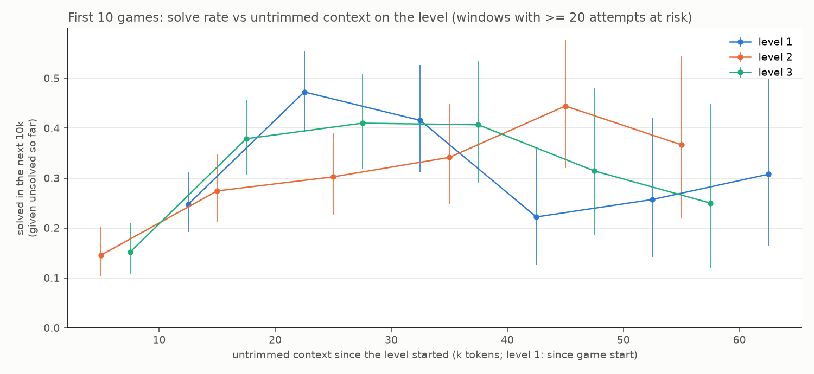

# Level 1-3 solve rate vs untrimmed context

Question: on the 15 harder public games, does the chance of solving the current level drop once the context fills and trimming starts (the 118,272-token budget)?


**Answer: level 1 dips at the trimming line; levels 2 and 3 do not.** Level 1 holds at roughly 15-25% per 10k tokens from 30k to 118k, then drops to about 8-9% in the next two windows. Measured from the start of each level, level 2 ramps up over the first 40k to about 8-10%, holds there to about 100k, then sits near 5-7%. Level 3 ramps up over the first 50k, peaks at 13-18% around 60-80k, holds at about 10-15% to 130k, then falls off. Their trimming points vary with how full the context was when the level began, so the budget line applies to level 1 only.

The level-1 dip: of attempts unsolved at 90k, 55/112 (49%) solved before 118k; of those unsolved at 118k, 16/54 (30%) solved before 150k (Fisher's exact on that 2x2 table: odds ratio 2.29, p = 0.020, optimistic because an attempt can be in both rows). It is not uniform: bp35 20/25 -> 2/5, g50t 10/19 -> 2/7 and cd82 6/12 -> 2/6 drop, while sk48 rises 4/26 -> 6/21. Part of it comes from which games are still on level 1 by then: 21 of the 54 attempts past 118k are sk48. Comparing within the same game, the odds ratio is 0.60 (95% CI 0.28-1.27, p = 0.18). The direction fits trimming hurting level 1, but this sample cannot separate it from hard games remaining.

Before trimming, level 1 gets easier as context grows. From 30k to 118k, within the same game, the odds of solving in the next 10k rise 1.24x per +10k of untrimmed context (95% CI 1.12-1.36, p = 2e-5, errors clustered by attempt). Pooled across games the trend is flat (0.99, CI 0.92-1.08), because the mix shifts toward hard games as context grows. Together with the dip after the line, this points to retained context helping on level 1. A direct test would be an A/B run with a larger context budget on the hard games, or with the first trim delayed.

## Level-up rate vs current context

The figure above cannot show trimming for levels after 1, because each attempt starts at a different point of the context sawtooth. This one uses the current (trimmed) context instead, which cycles between about 58k and 118k, and keeps only turns after the game's first trim. It shows levels 1-3 and each game's final level.


**No optimal range within 50-118k for levels 1-3.** Within game and level, per +10k of current context (Poisson, the quadratic term tests for a peak):

| Series | Rate ratio per +10k | 95% CI | Peak (quadratic) p | Level-ups |
|---|---:|---:|---:|---:|
| Level 1 | 0.96 | 0.76-1.22 | 0.51 | 24 |
| Level 2 | 0.96 | 0.88-1.05 | 0.51 | 167 |
| Level 3 | 0.98 | 0.91-1.06 | 0.27 | 199 |
| Final level | 1.09 | 0.89-1.34 | 0.074 | 26 |

- Level 2 stays at 0.05-0.08 per 10k across the range, slightly lower above 100k.
- Level 3 moves between 0.06 and 0.12 with no direction.
- Level 1 has few attempts left after the first trim (24 level-ups), so its intervals are wide.
- The final level is the only curve with a hump: 0.04-0.08 at 50-70k, 0.09-0.13 at 75-90k, 0.05-0.06 above 100k. The peak test is p = 0.074 on 26 level-ups, so it is a hint, not a finding.
- On real prompt sizes (request-log runs), level 3 rises 1.26x per +10k (CI 1.02-1.55, p = 0.034, 34 level-ups) and level 2 is 1.05x (CI 0.79-1.41). Levels 1 and final have too few level-ups there.

The current context is simulated for most runs, so it is noisy, and that noise pulls any real trend toward flat.

How it is measured:
- **x:** the current context at the start of each turn. Only the request-log runs record it, so for the 30 runs it is simulated from the untrimmed estimate: it grows with each turn, and once it passes 118k it drops to 58k. Those values were fitted against server `prompt_tokens`: median error 3k tokens, but correlation only 0.60 inside the 50-118k band, because each trim lands a little differently and the phase drifts.
- **y:** level-ups per 10k of context added while in that window. The bars are exact Poisson 95% intervals.
- **Test:** a Poisson model with game and level fixed effects, offset by added context, errors clustered by game run; a second fit adds a quadratic term.

## Does keeping the last level-up in context help?

For levels 2 and 3, each turn is marked by whether the turn that completed the previous level is still in the trimmed context. After a trim, the context keeps roughly the newest (current - base) tokens, so the level-up is kept if the untrimmed context added since it fits in that.

At the same tokens since the level-up, some attempts have already lost it to a trim and others have not, depending on where in the sawtooth the level began. The columns cover 40-100k since the level-up, where both cases occur. The adjusted ratios compare within the same 20k band, game and level, offset by added context, errors clustered by game run.


| Level | Kept vs trimmed away (adjusted) | 95% CI | p | Level-ups |
|---|---:|---:|---:|---:|
| Level 2 | 0.93 | 0.56-1.54 | 0.77 | 132 |
| Level 3 | 1.53 | 0.91-2.58 | 0.11 | 101 |
| Levels 2-3 | 1.11 | 0.80-1.55 | 0.54 | 233 |

**No significant effect.** Level 2 shows no difference. Level 3 leans toward keeping the level-up helping, at 1.53x, but the interval includes 1. On the request-log runs with real prompt sizes, levels 2-3 come out at 0.48x (CI 0.15-1.53, 46 level-ups), the other way. Simulated trims mislabel some turns, which pulls the estimate toward 1. An A/B run of `context.retain_last_level_up` (PR #31) would settle it. Script: [`scripts/levelup_in_context.py`](scripts/levelup_in_context.py).

## First 10 games

The same figure for the 10 easier games (20 Daniel-harness runs that include them, 194 game runs):



These games rarely meet trimming. Levels 1-3 are solved in 192/194, 191/192 and 188/191 attempts, at a median of 20-27k tokens into the level, far below the 118k budget. The solve rate peaks at 40-47% per 10k by 20-45k, against 15-25% for level 1 of the later 15. So any context effect is a later-15 question.

## Data

- **Games:** the later 15 public games (bp35 cd82 cn04 dc22 g50t ka59 lf52 ls20 m0r0 s5i5 sk48 sp80 su15 tn36 wa30). The 10-game runs used the other 10.
- **Runs:** every run in `ARC3-Inference/runs/kaggle` on Daniel's harness: 118,272-token budget, 3,072-token tool output, no sampled-animation or intermediate-frame images. That is 30 runs and 320 game runs. Short runs and the early-level-recovery arms are included; a run that ends mid-level counts that level as unsolved at that point.
- **Excluded:** the `context-transition-reminders` and `view-tool` runs (they change context or tools), main's harness runs (1,024-token tool output, sampled animations or intermediate frames), the `bp35-lordhansolo` series, and runs with other budgets.
- **Sample size:** level 1 has 407 attempts (373 solved), level 2 has 373 (273 solved), level 3 has 273 (215 solved).

## Method

**x-axis.** x is the untrimmed context added since the level started: everything that entered the conversation since the previous level-up, as if history were never trimmed. Level 1 counts from game start, so it includes the base prompt.
- Only five runs log server `prompt_tokens`, so x is rebuilt from each transcript. It counts user prompts, thinking, replies, tool calls and tool results, plus a cost per attached image. The per-turn copy of the system prompt and the status blocks are excluded.
- The fit (`base + chars/2.92 + 350 * images`) uses the runs that saved request logs, at each turn's first request before the game's first trim (n = 2,347).
- Median absolute error is 3.3%, and the 90th percentile is 8.5%.

**Level-ups.** Level-ups come from each game's events file. A level-up at action *a* ends at the untrimmed context reached by the end of the turn that executed *a*. The next level starts there.

**y-axis.** For each 10k window: among attempts on that level that started before the window and were unsolved at its start, the share solved inside it. Windows with fewer than 20 attempts at risk are omitted. The bars are 95% Wilson intervals.

## Caveats

- Later windows hold the attempts that are still unsolved, which are mostly the hard games. A falling raw curve can therefore come from the mix of games rather than from the context.
- One attempt counts in every window it spans, so the windows are not independent, and the intervals are narrower than they should be.

## Reproduce

From the repo root:

```bash
RUNS_DIR=<main checkout>/ARC3-Inference/runs/kaggle python3 docs/harness/scripts/solve_rate_vs_context.py
RUNS_DIR=<main checkout>/ARC3-Inference/runs/kaggle GAME_SET=first10 python3 docs/harness/scripts/solve_rate_vs_context.py
```

[`scripts/solve_rate_vs_context.py`](scripts/solve_rate_vs_context.py) writes both figures and prints the calibration, the run list and the per-window counts.
