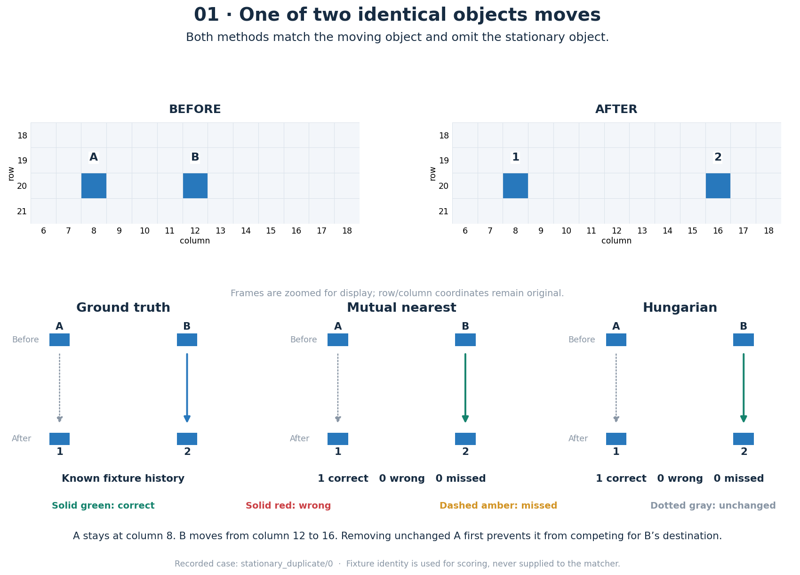
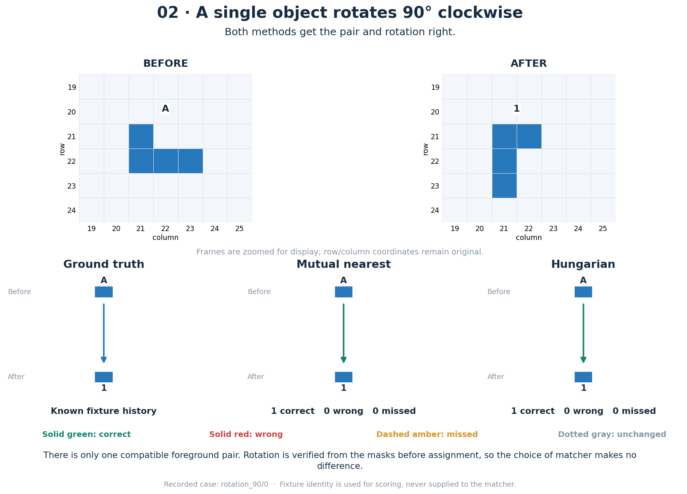
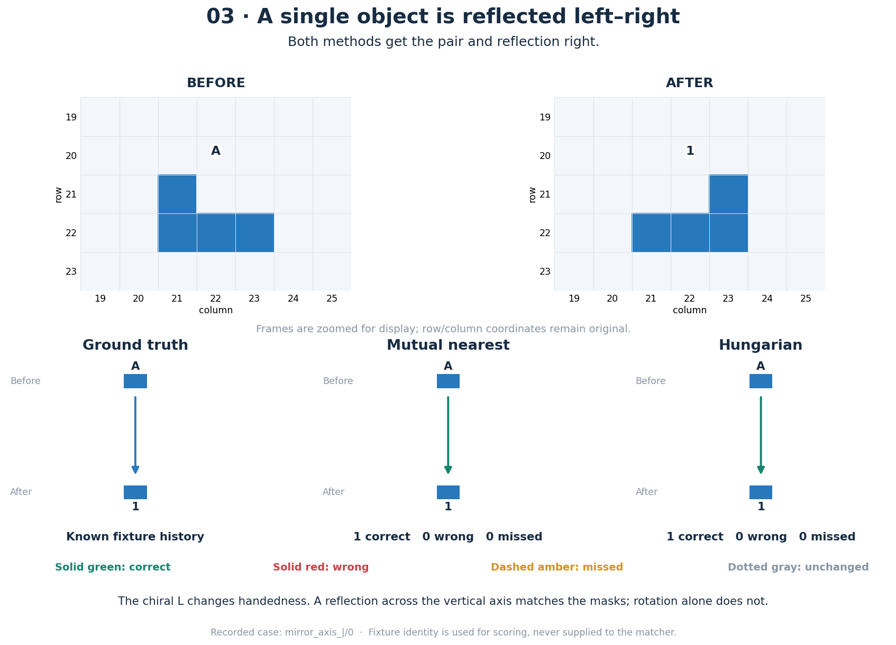
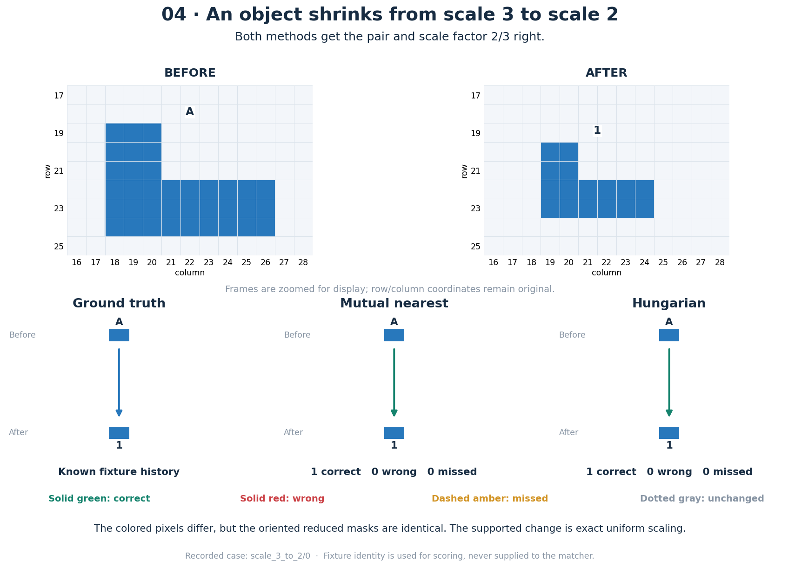
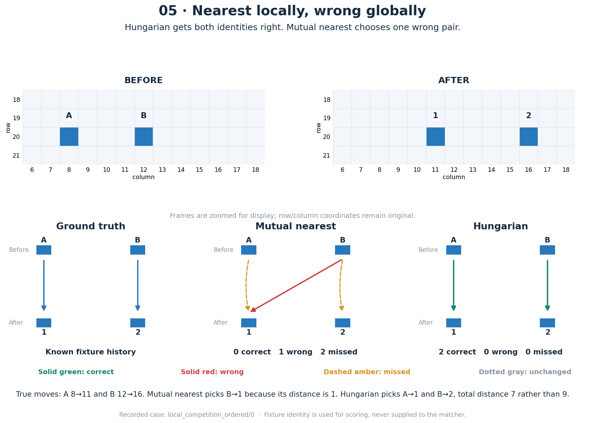
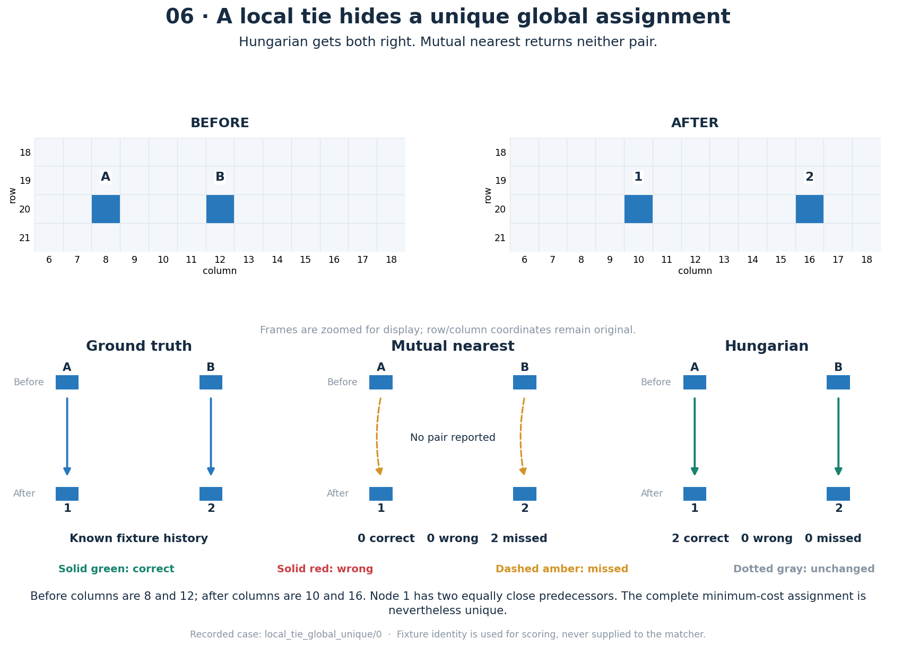
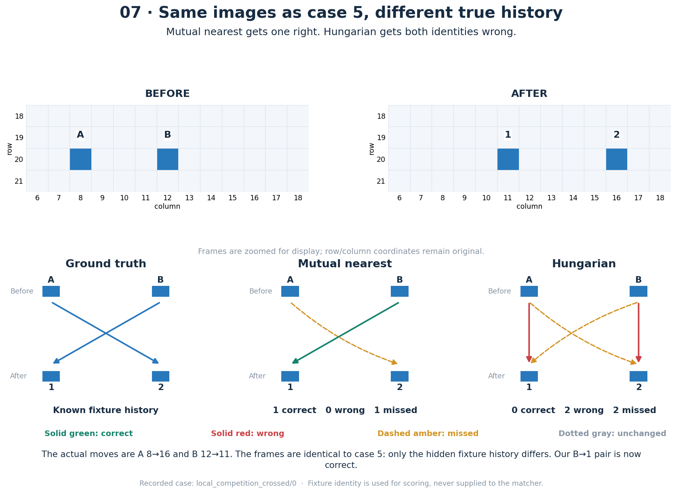
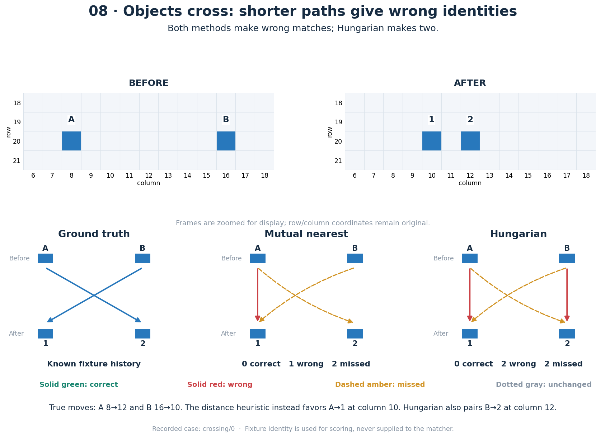
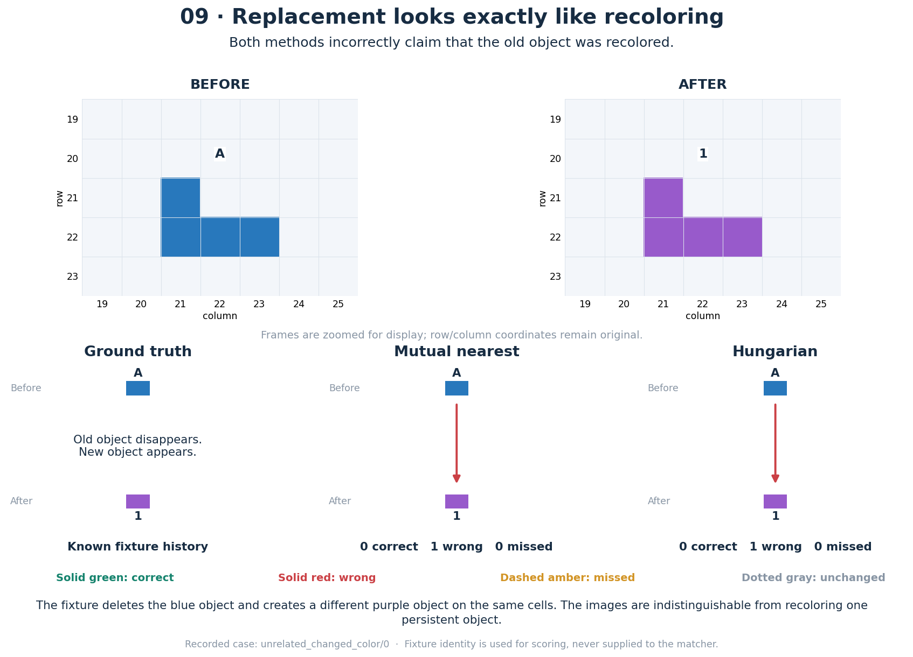
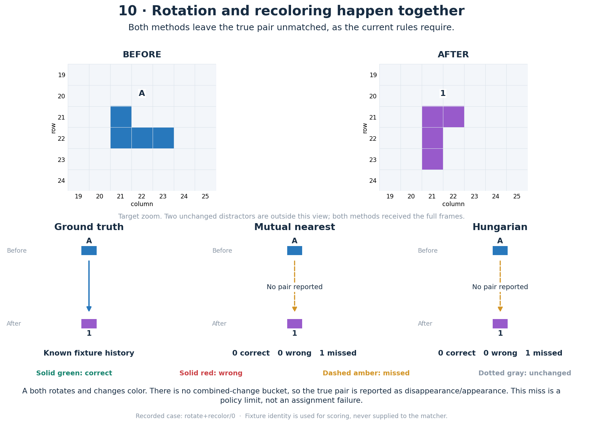

# Ten visual matching cases

These figures use recorded test fixtures. Mutual nearest is the evaluated alternative; Hungarian is retained in production. Green arrows are correct matches, red arrows are wrong matches, amber dashed arrows are missed true pairs, and gray dotted arrows are unchanged objects omitted from the diff. Arrows below the frames show correspondence, not physical motion.

[Download all ten figures as a PDF](figures/matching_examples.pdf). The PNG and SVG files are in [figures/cases/](figures/cases/).

| Case | Example | Mutual nearest: correct / wrong / missed | Hungarian: correct / wrong / missed |
|---|---|---:|---:|
| 01 | One of two identical objects moves | 1 / 0 / 0 | 1 / 0 / 0 |
| 02 | A single object rotates 90° clockwise | 1 / 0 / 0 | 1 / 0 / 0 |
| 03 | A single object is reflected left–right | 1 / 0 / 0 | 1 / 0 / 0 |
| 04 | An object shrinks from scale 3 to scale 2 | 1 / 0 / 0 | 1 / 0 / 0 |
| 05 | Nearest locally, wrong globally | 0 / 1 / 2 | 2 / 0 / 0 |
| 06 | A local tie hides a unique global assignment | 0 / 0 / 2 | 2 / 0 / 0 |
| 07 | Same images as case 5, different true history | 1 / 0 / 1 | 0 / 2 / 2 |
| 08 | Objects cross: shorter paths give wrong identities | 0 / 1 / 2 | 0 / 2 / 2 |
| 09 | Replacement looks exactly like recoloring | 0 / 1 / 0 | 0 / 1 / 0 |
| 10 | Rotation and recoloring happen together | 0 / 0 / 1 | 0 / 0 / 1 |

Cases 5 and 7 deliberately show identical observed frames with different hidden identities. They demonstrate an information limit, not a contradiction. Case 10 is an intentional single-change-policy rejection. Background records are excluded from the foreground matching counts, as in the study.

## 01. One of two identical objects moves

Both methods match the moving object and omit the stationary object.

A stays at column 8. B moves from column 12 to 16. Removing unchanged A first prevents it from competing for B’s destination.

Source fixture: `stationary_duplicate/0`.

## 02. A single object rotates 90° clockwise

Both methods get the pair and rotation right.

There is only one compatible foreground pair. Rotation is verified from the masks before assignment, so the choice of matcher makes no difference.

Source fixture: `rotation_90/0`.

## 03. A single object is reflected left–right

Both methods get the pair and reflection right.

The chiral L changes handedness. A reflection across the vertical axis matches the masks; rotation alone does not.

Source fixture: `mirror_axis_|/0`.

## 04. An object shrinks from scale 3 to scale 2

Both methods get the pair and scale factor 2/3 right.

The colored pixels differ, but the oriented reduced masks are identical. The supported change is exact uniform scaling.

Source fixture: `scale_3_to_2/0`.

## 05. Nearest locally, wrong globally

Hungarian gets both identities right. Mutual nearest chooses one wrong pair.

True moves: A 8→11 and B 12→16. Mutual nearest picks B→1 because its distance is 1. Hungarian picks A→1 and B→2, total distance 7 rather than 9.

Source fixture: `local_competition_ordered/0`.

## 06. A local tie hides a unique global assignment

Hungarian gets both right. Mutual nearest returns neither pair.

Before columns are 8 and 12; after columns are 10 and 16. Node 1 has two equally close predecessors. The complete minimum-cost assignment is nevertheless unique.

Source fixture: `local_tie_global_unique/0`.

## 07. Same images as case 5, different true history

Mutual nearest gets one right. Hungarian gets both identities wrong.

The actual moves are A 8→16 and B 12→11. The frames are identical to case 5: only the hidden fixture history differs. Our B→1 pair is now correct.

Source fixture: `local_competition_crossed/0`.

## 08. Objects cross: shorter paths give wrong identities

Both methods make wrong matches; Hungarian makes two.

True moves: A 8→12 and B 16→10. The distance heuristic instead favors A→1 at column 10. Hungarian also pairs B→2 at column 12.

Source fixture: `crossing/0`.

## 09. Replacement looks exactly like recoloring

Both methods incorrectly claim that the old object was recolored.

The fixture deletes the blue object and creates a different purple object on the same cells. The images are indistinguishable from recoloring one persistent object.

Source fixture: `unrelated_changed_color/0`.

## 10. Rotation and recoloring happen together

Both methods leave the true pair unmatched, as the current rules require.

A both rotates and changes color. There is no combined-change bucket, so the true pair is reported as disappearance/appearance. This miss is a policy limit, not an assignment failure.

Source fixture: `rotate+recolor/0`.
