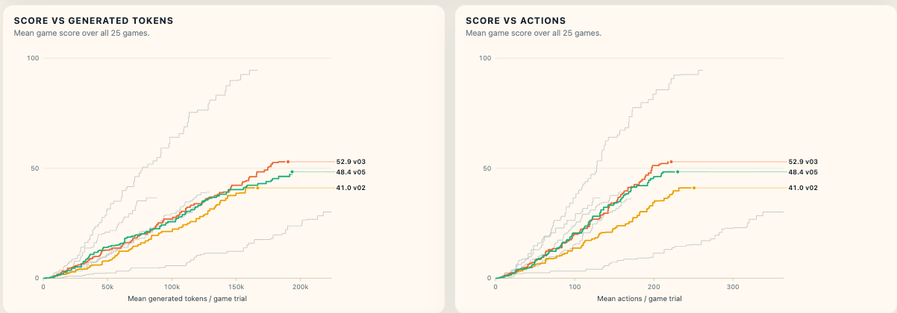
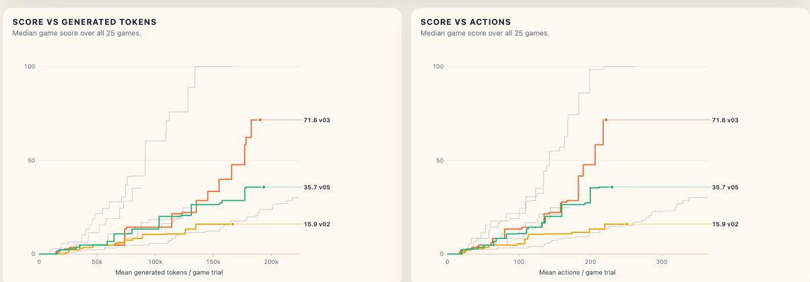

# Thinking budget and user prompt trim

[Pull request #4](https://github.com/Wang-Zhongwei/arc-agi-3-solution/pull/4)

## Experiment arms

| Arm | Thinking budget per request | User prompt | Kaggle notebook | Version | Observed runtime |
| --- | --- | --- | --- | --- | --- |
| Baseline | No thinking budget cap | Full prompt | [ticbudja/thinking-budget-and-user-prompt-trim](https://www.kaggle.com/code/ticbudja/thinking-budget-and-user-prompt-trim) | v1 | 1h 31m 25s |
| Baseline | No thinking budget cap | Full prompt | [dangthuygiang/arc3-v207-danibase-base-dfranzen](https://www.kaggle.com/code/dangthuygiang/arc3-v207-danibase-base-dfranzen) | v5 | 2h 13m 6s |
| 4,096-token budget | 4,096 tokens | Repeated tool instructions removed | [ticbudja/thinking-budget-and-user-prompt-trim](https://www.kaggle.com/code/ticbudja/thinking-budget-and-user-prompt-trim) | v2 | 2h 4m 59s |
| 8,192-token budget | 8,192 tokens | Repeated tool instructions removed | [ticbudja/thinking-budget-and-user-prompt-trim](https://www.kaggle.com/code/ticbudja/thinking-budget-and-user-prompt-trim) | v3 | 2h 12m 17s |

Observed runtimes are the benchmark durations reported in each run's `summary.txt`.

## Comparisons

### Mean

### Median

## Paired t-tests on final scores

Using the [across-game paired t-test](../rules/t-test.md) on final scores for the same 25 games, v3 improves observed mean score over v2 (52.92 vs 41.04; two-sided p = 0.0263) and remains close to v5 (48.36; p = 0.3413). V2 versus v5 gives p = 0.1260. V5, v2, and v3 have approximately comparable runtimes, although v2 ran about seven minutes less than v3. These are exploratory, unadjusted tests: the v3–v2 result does not survive correction across all three comparisons, and the test does not establish equivalence to baseline. [Full results and method](data/thinking_budget_ttest_final.json), [per-game scores](data/thinking_budget_ttest_final.csv), and [reproduction script](scripts/compare_thinking_budget.py) (`--final`).

## Reason for merging

The feature provides a knob to cap thinking tokens per request. If we increase `max_model_len`, vLLM's context limit will allow longer thinking before terminating generation. An explicit thinking budget lets us tune that behavior independently of the context window.

V3 performs better than v2 in the observed runs and remains close to baseline on mean score. Its final median score also shows a positive signal: 71.60 versus 35.71 for v5 and 15.92 for v2. Together with the configurable thinking budget, these results support merging the feature.
