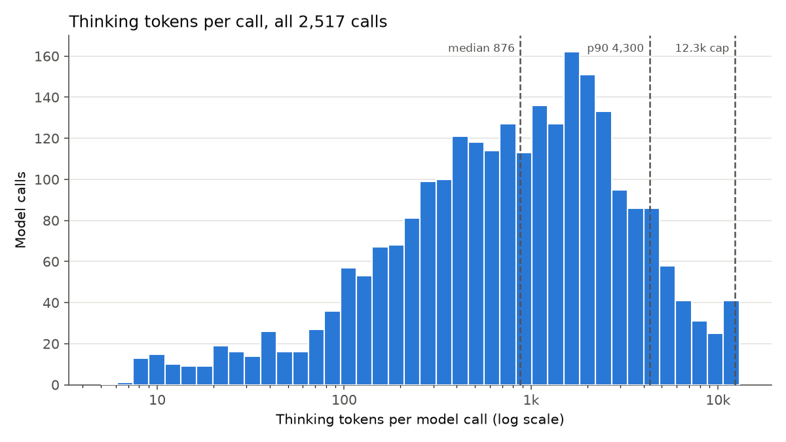
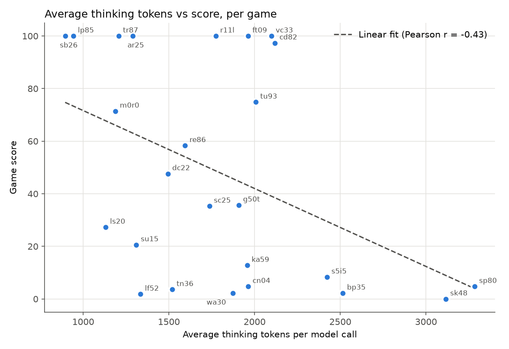
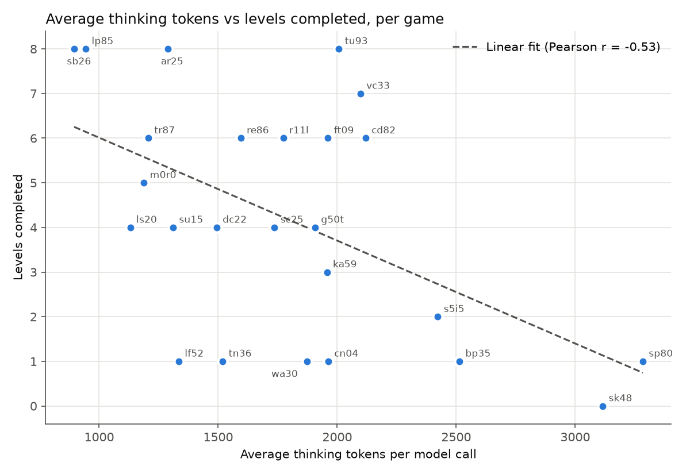

# Thinking budget study of Daniel's base notebook

How many reasoning tokens Daniel's base notebook spends, and how that
correlates with score. Run: Kaggle `dangthuygiang/arc3-v207-danibase-base-dfranzen`
v05, 1 pass over 25 games, 8 won, mean score 48.36. Counts come from
`usage.reasoning_tokens` on all 2,517 model responses in the per-game
`*_p0_requests.jsonl` logs.

Regenerate the tables, `data/thinking_budget.csv`, and all three plots with:

```bash
python3 docs/reasoning/scripts/thinking_budget.py
```

The script reads the run from
`../duck-harness/ARC3-Inference/runs/kaggle/dangthuygiang/arc3-v207-danibase-base-dfranzen/v05`.

## Overall

- **Total thinking:** 4,258,137 tokens, 86.4% of the 4.93M generated tokens.
- **Distribution:** thinking tokens distributions is close to log-normal with long tail on the high end.

Thinking tokens per call:


| mean  | median | p10 | p25 | p75   | p90   | p95   | p99    | max    | std   |
| ----- | ------ | --- | --- | ----- | ----- | ----- | ------ | ------ | ----- |
| 1,692 | 876    | 105 | 293 | 2,102 | 4,300 | 6,172 | 12,288 | 12,291 | 2,240 |




- **Cap:** 34 calls (1.4%) ended with `finish_reason=length` at 12,288 to
12,291 tokens, because that's the difference between the harness context
window `LOCAL_ANALYZER_CONTEXT_WINDOW=131072` (128k) and the harness
truncation context limit `context_budget_tokens=118272`, less a 512-token
safety margin: 131,072 − 12,288 − 512 = 118,272. The 12,288 is
`max_output_tokens` (`LOCAL_ANALYZER_MAX_OUTPUT`), which covers thinking and
answer together. The sglang server allows more (`--context-length 139264`),
so the harness limit is the one that applies.


## Average thinking vs score and levels





- **Average thinking falls as score rises:** Pearson r = −0.43 against score and
r = −0.53 against levels completed.
- **Stuck games think the most per call:** sp80 (3,284), sk48 (3,115), bp35
(2,513), and s5i5 (2,422) clear at most 2 levels. They also hit the 12.3k cap
most often; s5i5 has 10 capped calls.
- **Easy wins think the least:** sb26 (895), lp85 (943), tr87 (1,206), and ar25  
(1,290) all score 100.


## Observations & Remarks

Models tend to think more when games are difficult, resulting in a long-tailed thinking token distribution. While extended reasoning provides richer context to condition subsequent actions on, it must reach a point of diminishing return beyond which excessive thinking bloats the context window without offering meaningful guidance. We may be better off capping per-turn thinking in favor of preserving context space for more interactive turns.

## Proposal

Truncate thinking budget to `4096`, around the p90. 