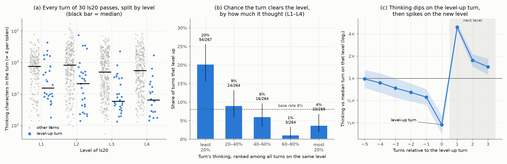

# Thinking per turn vs leveling up

Hypothesis: the model thinks longer when it is confused and less when it
understands, so turns with less thinking should be more likely to clear a level.

Different games and levels differ in difficulty, and harder ones draw more
thinking and fewer level-ups. Comparing across them would confound the two.
So this uses one game, ls20 (7 levels), from the api-signatures study: 30 passes
(3 arms × 10) of the same levels, where each turn is compared only with turns on
the same level.

| Arm | Run | Turns | Level-ups |
| --- | --- | ---: | ---: |
| v0 | `jonathanwang2022/api-signatures-and-frame-diff` v3 | 472 | 39 |
| v1 | `jonathanwang2022/api-signatures-and-frame-diff` v5 | 579 | 35 |
| v2 | `ticbudja/api-signatures-and-frame-diff` v1 | 571 | 36 |

A turn is one `analysis_step`: the model calls before an `action()` plus the
actions it executes. Thinking is the summed `reasoning_chars` of those calls
(about 4 characters per token). The turn levels up if one of its actions has
`level_completed`. Tests use L1–L4; later levels have at most 3 level-ups.



## Result

**Turns that clear a level think about 4–8× less than other turns on the same level.**

| Level | Median chars, level-up turn | Median chars, other turns | Ratio | Mann–Whitney p |
| --- | ---: | ---: | ---: | ---: |
| L1 | 1,520 (n=30) | 7,527 (n=246) | 0.20 | 0.0014 |
| L2 | 2,125 (n=29) | 8,151 (n=314) | 0.26 | 0.00026 |
| L3 | 584 (n=28) | 4,947 (n=353) | 0.12 | 2e-6 |
| L4 | 636 (n=20) | 5,478 (n=304) | 0.12 | 2e-6 |

- **(b) Level-up chance falls with thinking.** Among turns in the lowest 20% of
  thinking for their level, 20% clear it; in the top 60%, 1–6% do (base rate 8%).
- **Logistic regression with level fixed effects:** each doubling of thinking
  multiplies the odds of leveling up that turn by 0.68 (95% CI 0.62–0.74). It
  is 0.72 (0.65–0.80) after also controlling for actions in the turn, arm, and
  turns already spent on the level. Each arm alone gives 0.55–0.73.
- **(c) Thinking falls before the level-up and jumps after it.** Thinking
  drifts down over the 5 turns before a level-up (1× → about 0.55× the level's
  median). It reaches about 0.24× on the level-up turn, then about 5× on the
  first turn of the next level.

The 60 games of Daniel v05, UCB v01 and Milestone-2 v01 show the same pattern
(request-log token counts, thinking ranked within game): the level-up turn
thought less than the median of that level's other turns in 73% of 226 levels.

## Reading it

The data fit the hypothesis. Thinking rises when a new level appears, falls as
the agent works it out, and is lowest on the turn that clears the level.

This is a correlation, not a mechanism:

- **The level-up turn often just executes a plan.** The plan is often worked
  out on earlier turns, so the low-thinking turn may reflect understanding
  reached earlier. The steady decline before the level-up in (c) is consistent
  with that.
- **Thinking also falls with time on a level** (Spearman −0.36 on non-level-up
  turns). The effect holds after controlling for this, but some of it is shared.
- **This does not show that capping thinking helps.** Low thinking marks
  understanding; it does not create it.

Possible uses: a falling thinking trend could serve as a confidence signal,
for example allowing longer action batches once thinking is well below the
level's running median. A thinking spike well into a level could signal being
stuck. Test either as an A/B arm before relying on it.

## Reproduce

From the repo root, with the three runs pulled under `ARC3-Inference/runs/kaggle/`
(or `ARC3_RUNS_DIR` set):

```bash
python3 docs/reasoning/scripts/thinking_vs_level_up.py
```

It writes `data/ls20_turns.csv` (one row per turn) and the figure, and prints the tests.
