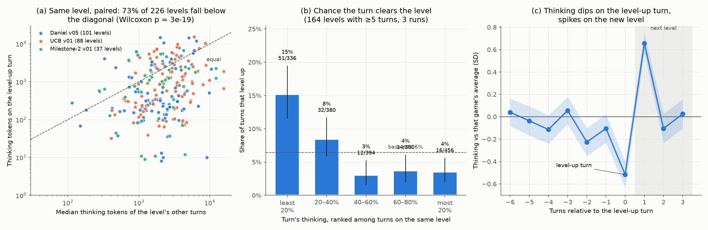

# Thinking per turn vs leveling up

Question: does the model think less on turns where it clears a level? The idea
is that it thinks longer when confused and less once it understands the level.

## Runs

| Study | Kaggle run | Games × passes | Thinking measure |
| --- | --- | --- | --- |
| ls20, arm v0 | `jonathanwang2022/api-signatures-and-frame-diff` v3 | ls20 × 10 | `reasoning_chars` in event sidecars |
| ls20, arm v1 | `jonathanwang2022/api-signatures-and-frame-diff` v5 | ls20 × 10 | same |
| ls20, arm v2 | `ticbudja/api-signatures-and-frame-diff` v1 | ls20 × 10 | same |
| Cross-check | `dangthuygiang/arc3-v207-danibase-base-dfranzen` v5 | 25 games × 1 | `usage.reasoning_tokens` in request logs |
| Cross-check | `ticbudja/yield-ucb-scheduling-v1` v1 | 25 games × 1 | same |
| Cross-check | `dfranzen/arc-agi-3-milestone-2-solution` v1 | 10 games × 1 | same |

- **Turn:** one `analysis_step`, meaning the model calls up to an `action()`
  and the actions that call executes. Thinking is summed over the turn's calls.
  One token is about 4 characters.
- **Level-up turn:** a turn whose actions complete a level.

## Experiments

### 1. ls20: level-up turns vs other turns on the same level

Harder levels draw more thinking, so each level-up turn is compared only with
other turns on the same level, pooled over all 30 ls20 passes. That gives 1,622
turns and 110 level-ups; L1–L4 are used because later levels have at most 3
level-ups.


| Level | Median chars, level-up turn | Median chars, other turns | Ratio | Mann–Whitney p |
| --- | ---: | ---: | ---: | ---: |
| L1 | 1,520 (n=30) | 7,527 (n=246) | 0.20 | 0.0014 |
| L2 | 2,125 (n=29) | 8,151 (n=314) | 0.26 | 0.00026 |
| L3 | 584 (n=28) | 4,947 (n=353) | 0.12 | 2e-6 |
| L4 | 636 (n=20) | 5,478 (n=304) | 0.12 | 2e-6 |

- (b) Turns in the lowest 20% of thinking for their level clear it 20% of the
  time. Turns in the top 60% clear it 1–6% of the time. The base rate is 8%.
- (c) Thinking drifts down over the 5 turns before a level-up, to 0.56× the
  level's median. It reaches 0.24× on the level-up turn, then jumps to 5× on the
  first turn of the next level.

### 2. ls20: controlling for other explanations

A logistic regression predicts whether a turn levels up from its log thinking.
It controls for level, arm, the number of actions in the turn, and the turns
already spent on the level, since thinking also falls over time on a level
(Spearman −0.36).

| Model | Odds of leveling up per doubling of thinking |
| --- | ---: |
| level only | 0.68 [0.62, 0.74], p = 4e-16 |
| + actions, arm | 0.65 [0.59, 0.72], p = 8e-18 |
| + actions, arm, turns on level | 0.72 [0.65, 0.80], p = 8e-10 |
| each arm alone (level only) | v0 0.73, v1 0.70, v2 0.55; all p < 1e-4 |

### 3. Cross-check on 60 games from three other runs

The same tests on runs with exact token counts check that the effect is not
specific to ls20. Because these runs span many games, thinking is compared only
within each game or level.



- (a) In 73% of 226 completed levels, the level-up turn thought less than the
  median of that level's other turns (Wilcoxon p = 3e-19).
- With game fixed effects, each 1 SD more thinking (within the game) multiplies
  the odds of leveling up by 0.42 (Daniel v5), 0.40 (UCB v1) and 0.47
  (Milestone-2 v1), all p < 0.001.
- (c) The same dip on the level-up turn and spike on the next level appear.

## Conclusion

Less thinking on a turn goes with a higher chance of clearing the level on that
turn. On ls20 the level-up turn thinks 4–8× less than other turns on the same
level. The effect holds after controls, in every arm, and across 60 games from
three other runs. Thinking falls as the agent works a level out and jumps when
a new level appears, which fits the idea that thinking tracks confusion.

This is a correlation. The level-up turn often just carries out a plan worked
out on earlier turns, and it does not show that capping thinking would help.
It does suggest a usable signal: thinking well below the level's running median
means the agent likely understands the level, and a spike late in a level
means it is likely stuck. Test either signal as an A/B arm before relying on it.

## Reproduce

From the repo root:

```bash
python3 docs/reasoning/scripts/thinking_vs_level_up_ls20.py    # experiments 1-2 -> data/ls20_turns.csv
ARC3_RUNS_DIR=../duck-harness/ARC3-Inference/runs \
python3 docs/reasoning/scripts/thinking_vs_level_up_games.py   # experiment 3 -> data/games_turns.csv
```

The cross-check needs the per-game `*_p0_requests.jsonl` logs, which only the
duck-harness copy of those runs has.
