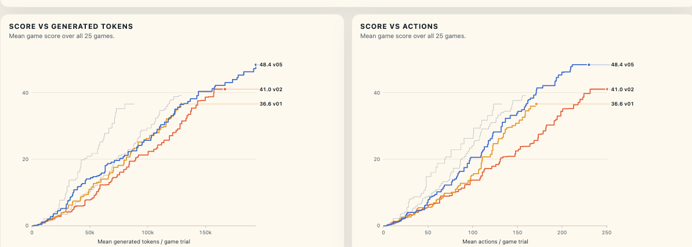

# Proposal

Submit `[ticbudja/thinking-budget-and-user-prompt-trim-submit](https://www.kaggle.com/code/ticbudja/thinking-budget-and-user-prompt-trim-submit)` version 2

It has 2 main changes:

- thinking tokens = 4096 (which turns to be negative)
- trim redundant part of the user prompt (uncertain)

# Extra fix

[10.01](1001.md) submission is UCB 4 waves of 10/28 games. But [Daniel](https://www.kaggle.com/code/dfranzen/arc-agi-3-milestone-2-solution) and I was intended to use 1 wave of 10/110 games. Fix has been made
on branch `UCB-migrate` commit `9a2420` and merged into branch `thinking-budget-and-user-prompt-trim`. Submitted notebook 
`[thinking-budget-and-user-prompt-trim-submit](https://www.kaggle.com/code/ticbudja/thinking-budget-and-user-prompt-trim-submit)` version 2, a shorter run public games to race against today's submission deadline,
rather than `[thinking-budget-and-user-prompt-trim](https://www.kaggle.com/code/ticbudja/thinking-budget-and-user-prompt-trim)` version 2. 

# Confession

Compare `[ticbudja/thinking-budget-and-user-prompt-trim](https://www.kaggle.com/code/ticbudja/thinking-budget-and-user-prompt-trim)` version 1/2 with `[ticbudja/yield-ucb-scheduling-v1](https://www.kaggle.com/code/ticbudja/yield-ucb-scheduling-v1)` version 1

I realized this is a wrong decision made. I didn't have enough time to run the full 132 minutes for version 1 because we were close to today's submission deadline. So I simply submitted 90-minute long v1 and it looks close to the baseline. However the v2 proves that `4096` thinking budget might be too low because it looks have affected model action effectiveness because of higher uncertainty. When I take a the median score it was even worse...

Another reason for submission is because of the bug fix from 10.01. Our previous duck-harness and Daniel both used 1 wave rather than 4 wave. From past submission's, lower wave would have better score because of stronger selection effect. 

Overall, thinking=4096 is a bad choice. 4 wave fix is a bet. 

